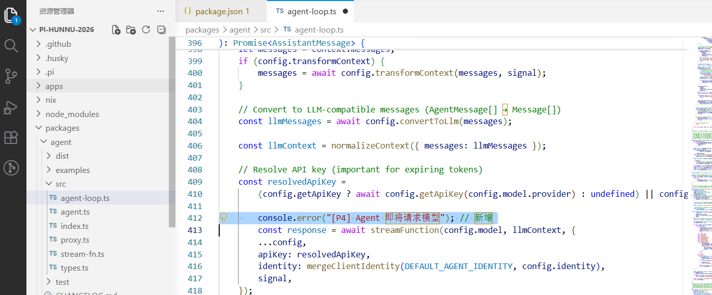
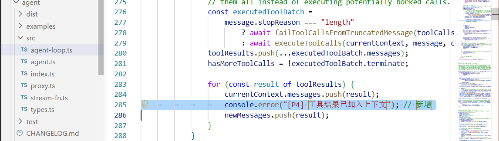
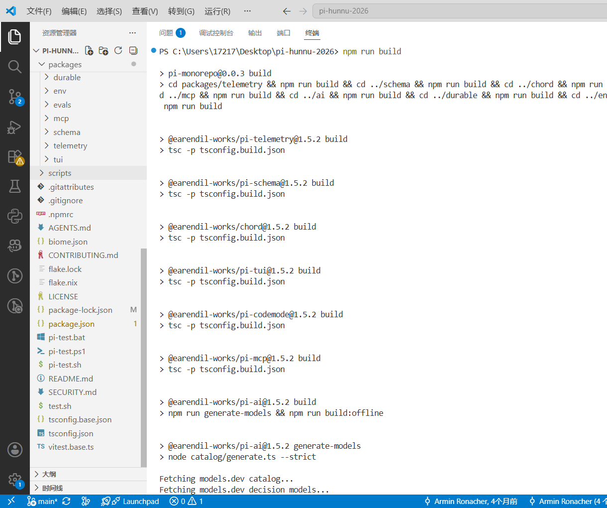
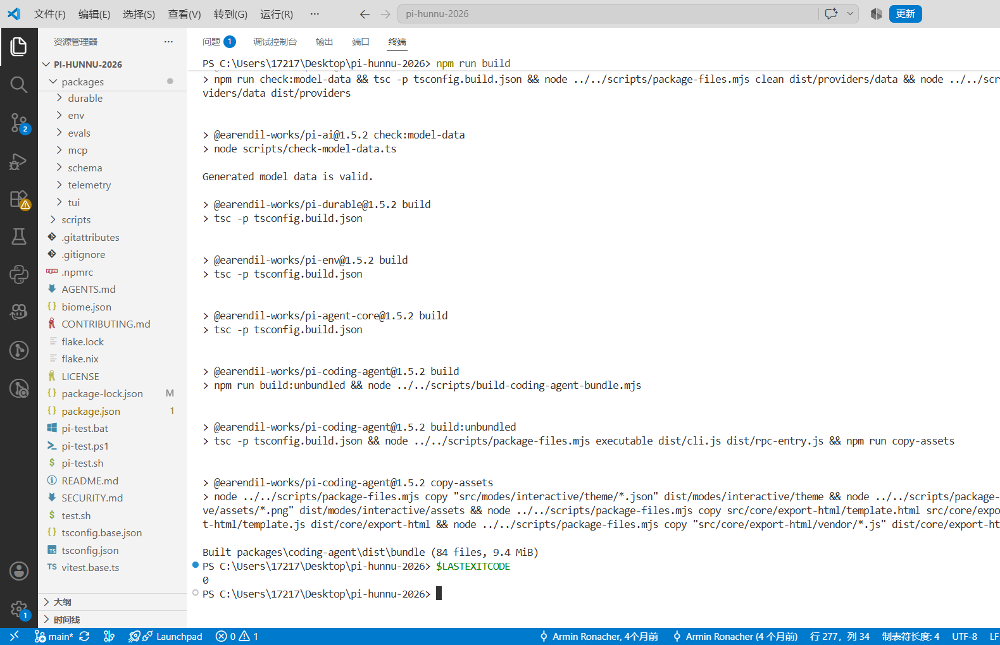
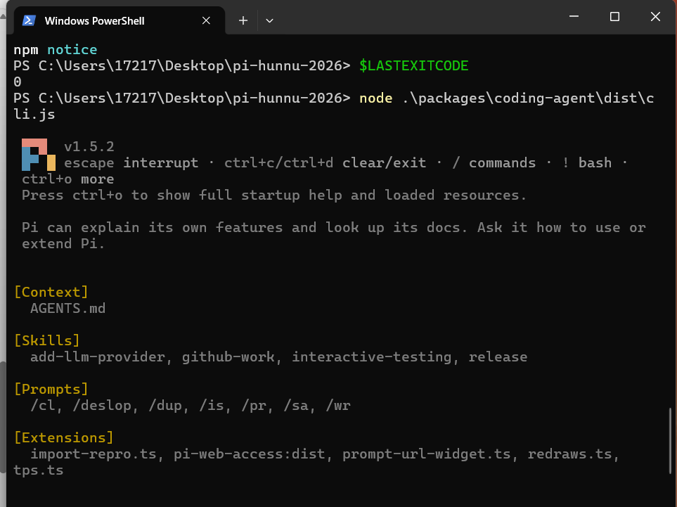
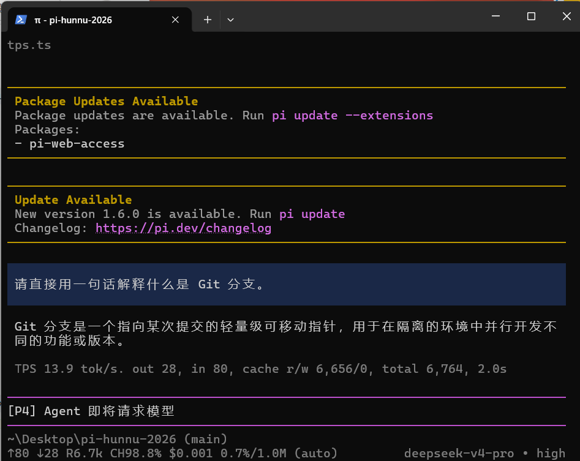
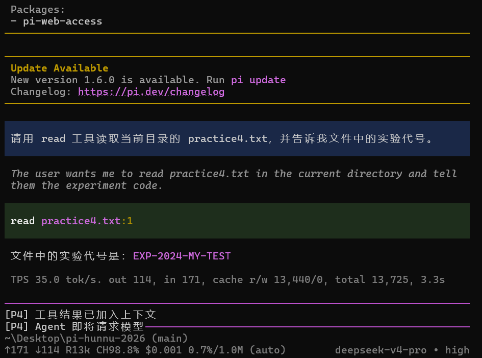
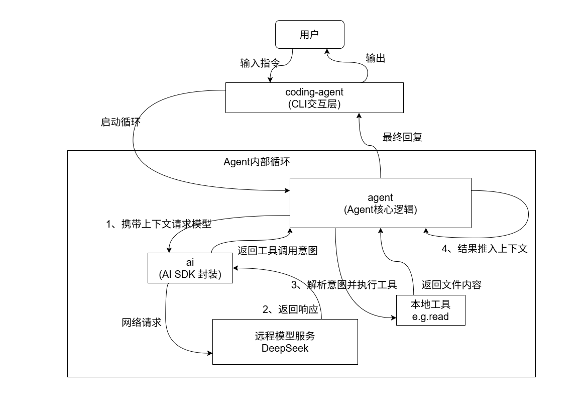

# 实践课4：Pi Agent 的模型调用与运行流程

## 任务一：给 Agent 循环加两行日志

根据实验要求，在 `packages/agent/src/agent-loop.ts` 中新增了两处日志打点，用于观察 Agent 的运行循环。

**1. 在模型调用前打印日志**
定位到原第 412 行，在 `const response = await streamFunction(...)` 上方插入日志。

**2. 在工具结果加入上下文后打印日志**
定位到原第 284 行，在 `currentContext.messages.push(result);` 下方插入日志。

---

## 任务二：重新编译并启动

保存源码后，在项目根目录重新编译并启动。
由于之前遇到网络超时问题，通过调整构建脚本/网络环境后，成功完成编译（`$LASTEXITCODE` 返回 0），并成功启动了 Pi 交互界面。

**1. 重新编译记录**

**2. 启动 Pi 交互界面**

---

## 任务三：对比两次运行

在根目录创建了 `practice4.txt`，并写入了实验代号 `EXP-2024-MY-TEST`。随后分别进行了两次会话测试。

### 1. 会话 A（直接问答）
- **输入指令**：`请直接用一句话解释什么是 Git 分支。`
- **日志与结果记录**：
  
- **分析**：Pi 直接利用自身的知识库进行了回答，**没有调用任何工具**。终端底部仅出现了一次 `[P4] Agent 即将请求模型` 日志，说明本次问答仅进行了 **1 轮** 模型调用。

### 2. 会话 B（读取文件）
- **输入指令**：`请用 read 工具读取当前目录的 practice4.txt，并告诉我文件中的实验代号。`
- **日志与结果记录**：
  
- **分析**：Pi 成功返回了文件中的代号 `EXP-2024-MY-TEST`。观察终端输出，完整呈现了 Agent 的循环流程（由于终端滚动，截图展示了循环的后半段，逻辑上完整对应以下顺序）：
  1. 首轮 `[P4] Agent 即将请求模型`（模型决定调用 read 工具）
  2. 模型输出斜体思考文本，随后绿底 `read practice4.txt:1` 执行读取
  3. 输出 `[P4] 工具结果已加入上下文`
  4. 紧接着输出 `[P4] Agent 即将请求模型`（拿着工具结果再次请求模型生成最终回复）
  本次会话一共进行了 **2 轮** 模型调用。

### 四、问题回答（结合B的日志）
1. **谁实际读了文件？** 
   答：是系统环境中的 **`read` 工具** 实际执行了文件读取操作，大模型本身无法直接读取本地文件。模型只负责决定“调用什么工具”和“传入什么参数”。

2. **下一轮模型请求多带了什么？** 
   答：多带了 `read` 工具读取到的 `practice4.txt` 的文件内容（`EXP-2024-MY-TEST`），这个结果作为 Tool Result 被追加到了 `currentContext.messages` 上下文列表中，并在下一轮请求时一并发送给了模型。

### 架构简图
以下是 `coding-agent`、`agent`、`ai` 和远程模型服务之间的调用流转简图： 
